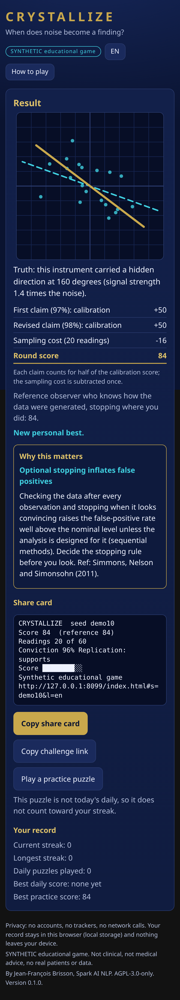

# Crystallize

**A two-minute reasoning game about evidence, calibration and replication.** SYNTHETIC educational game: every puzzle is generated in your browser from a seed. No real patients, no real data, no medical advice, no network calls, no accounts. Works offline on a phone.

Résumé FR : jeu éducatif SYNTHÉTIQUE de deux minutes sur la preuve, la calibration et la réplication. Un puzzle quotidien identique pour tous (graine = date), des puzzles d'entraînement illimités, une carte de partage en texte brut et des liens de défi. Interface EN/FR (langue du navigateur par défaut). Les détails sont ci-dessous en anglais.



## The game

An instrument emits noisy 2-D readings. Either it is pure noise, or it carries a hidden direction (the readings are noise plus a signal along one axis). Before you start you are told the **base rate**: what share of instruments like this one carry a hidden direction (20, 35, 50 or 65 percent, depending on the puzzle).

1. **Reveal readings** one at a time (each costs 0.8 points, 60 at most). The gold line is the largest-variance direction of what you have seen, and the number shown is its elongation (largest over smallest variance). Every finite sample has such a line, even pure noise, so the line alone is not evidence. It "crystallizes" as evidence accumulates, or it wanders.
2. **Commit** with a probability that a hidden direction exists (1 to 99 percent).
3. **Peer review.** Reviewer 2 replicates your claim: 20 fresh readings, one pre-registered test on the axis you claimed (variance along it over variance across it; under pure noise this ratio follows F(20, 20) and exceeds 2.12 about 5 percent of the time). You see the verdict and may revise your probability.
4. **Result.** The truth is revealed, you see the score breakdown, the score of a reference observer who knows the generator and stopped where you did, and a short "why this matters" card.

Play it in about two minutes. Keys: S reveal 1, F reveal 5, C commit.

## Scoring

Score = 0.5 x calibration(first claim) + 0.5 x calibration(revised claim) - 0.8 x readings used.

- `calibration(p) = 100 x (1 - 4 x Brier)`, where Brier is `(p - outcome)^2` with outcome 1 for a hidden direction and 0 for noise. It is 100 for a confident correct claim, 0 at 50 percent, and strongly negative for a confident wrong claim (about -292 for 99 percent on the wrong side). Probabilities are clamped to 1 to 99 percent.
- The Brier score is a **strictly proper** scoring rule: your expected score is highest when you report what you actually believe. The tests check this numerically.
- Each reading costs 0.8 points, so over-sampling is penalised; overclaiming is penalised by the Brier term. The base rate is part of the problem: reporting only the base rate scores about 14 on average, so a positive score needs evidence.
- A reference observer (exact Bayesian posterior for this generator, which the tests check is calibrated) that stops once its posterior leaves 10 to 90 percent averages about 50 points and 25 readings over 1500 simulated puzzles; fixed-length curves are in [docs/reference-curve.txt](docs/reference-curve.txt) (reproduce with `node scripts/reference-curve.js`). A typical good human round lands in the 20s to 60s.

## Virality, without tracking

- **Daily puzzle**, identical for everyone: the seed is the local calendar date. Day 1 is 2026-10-23.
- **Share card**: plain text, no emoji, copied to the clipboard. It shows the day, your score, the reference score, readings used, a conviction figure (distance from 50 percent, direction hidden so it does not spoil the puzzle) and a block-character bar:

  ```
  CRYSTALLIZE #1  2026-10-23
  Score 84  (reference 84)
  Readings 20 of 60
  Conviction 96% Replication: supports
  Score ████████░░
  Synthetic educational game
  ```

- **Challenge a colleague**: a link whose hash carries the seed and your score (`#s=SEED&b=SCORE`, or `#d=DATE`), so they play the same data and see the score to beat. Hash input is checked against a strict pattern; anything else falls back to the daily puzzle.
- **Streaks and personal bests** in `localStorage` only; unlimited practice puzzles with a personal-best record.
- **Educational card after every round**, chosen by what happened: small samples, every sample has a principal axis, a replication passing by chance, failed replication is not refutation, calibration, underconfidence, the winner's curse, base rates, the price of information, optional stopping.
- **EN/FR** (default from `navigator.language`); more languages are one dictionary each in `i18n.js`.

## Privacy

No accounts, no trackers, no network calls (the tests scan the built page for network APIs and remote URLs). Your record stays in this browser (local storage). Nothing leaves your device. Because the game runs entirely on the client, the puzzle's answer is computable from the page source: scores are for fun and learning, not a competition ranking.

## Run it

Open `dist/index.html` in a browser (one self-contained file, about 68 kB), or serve the folder:

```bash
python3 -m http.server 8099      # then open http://127.0.0.1:8099/
npm test                         # node --test: 57 tests, no dependencies
node build.js                    # rebuild dist/index.html from the sources
```

Sources: `index.html`, `style.css`, `i18n.js` (strings), `game.js` (pure logic: seeded RNG, generator, statistics, scoring, replication, lessons, streaks, hash links, share card), `app.js` (DOM only). Zero dependencies; Node 18 or later is only needed for the tests and the build.

## Tests

`npm test` runs 57 tests with Node's built-in runner:

- seeded RNG and generator determinism per seed, the daily puzzle being identical per date, the base-rate frequency of real instruments;
- statistics (eigen-decomposition on known data), the Bayesian reference observer being calibrated against the generator and beating the prior;
- scoring: strictly proper, monotone, clamped, sampling cost monotone, overclaiming penalised;
- replication: deterministic, uses fresh points, false-positive rate about 5 percent under pure noise (checks the F(20,20) threshold), more likely to pass on the true axis;
- streak, day-number (DST and leap-day safe), hash parsing and building, hostile input, impossible calendar dates, a corrupted saved record;
- share card format, no emoji, lines of at most 40 characters in EN and FR, no spoiler;
- i18n key and placeholder parity for every language, lessons present in every language;
- the built page has no network APIs or remote URLs, ids and i18n keys used by the code exist, accessibility basics, brand colours, no banned wording.

A headless-browser pass (Chrome through a development-only Playwright install, not part of the repo) played a full round on a 390 px phone, a 320 px phone and a desktop viewport, in English and French, with reduced motion, and found no console errors, no horizontal overflow and no external requests. That pass is not automated in CI.

Screenshots are in [docs/screenshots/](docs/screenshots/).

## Limits

- SYNTHETIC: two-dimensional Gaussian noise with a rank-one signal, noise sigma 1, signal amplitude 0.7, 1.0 or 1.4 times the noise, uniform direction. It teaches reasoning about evidence; it is not a model of any clinical or laboratory measurement.
- The scoring constants (cost 0.8, weight 0.5, thresholds, base rates) are hand-picked and tuned by a small simulation, not optimised.
- The reviewer's replication is a single one-sided test with 20 readings and limited power; the game says so.
- Client-side only: the answer can be read from the source, and share cards are self-reported.
- The reference observer is exact only for this generator and is a benchmark, not a claim about people.
- Contrast ratios were computed (all text at least 8:1); no screen-reader session was run.

See [DESIGN.md](DESIGN.md) for the statistics and decisions, and [CHANGELOG.md](CHANGELOG.md).

## Relation to other work

The "hidden direction that emerges as evidence accumulates" idea comes from the author's [membrane-crystallization](https://doi.org/10.5281/zenodo.23583050) streaming-PCA package; the reward-and-contest experiments are in crystallization-contest. This game is independent of both and uses only the idea.

## References

- Brier, G. W. (1950). Verification of forecasts expressed in terms of probability. *Monthly Weather Review* 78(1), 1-3.
- Gneiting, T. and Raftery, A. E. (2007). Strictly proper scoring rules, prediction, and estimation. *Journal of the American Statistical Association* 102(477), 359-378. https://doi.org/10.1198/016214506000001437
- Ioannidis, J. P. A. (2005). Why most published research findings are false. *PLoS Medicine* 2(8), e124. https://doi.org/10.1371/journal.pmed.0020124
- Simmons, J. P., Nelson, L. D. and Simonsohn, U. (2011). False-positive psychology. *Psychological Science* 22(11), 1359-1366. https://doi.org/10.1177/0956797611417632
- Brisson, J.-F. membrane-crystallization v0.1.0. https://doi.org/10.5281/zenodo.23583050

## How to cite

See [CITATION.cff](CITATION.cff).

## License

Copyright (c) 2026 Jean-François Brisson, Spark AI NLP.

This software is available under the GNU Affero General Public License v3.0 only (AGPL-3.0-only); see [LICENSE](LICENSE).
